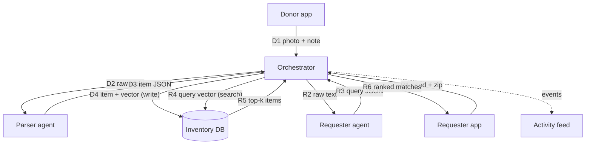
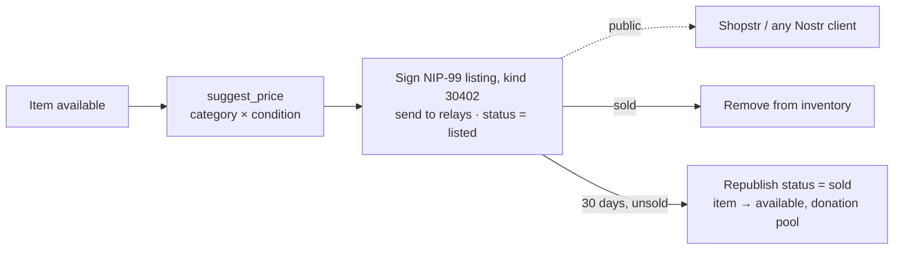

# 02 · Architecture

## Components

| Component | Where | Responsibility |
|---|---|---|
| Donor app | `frontend/src/routes/donate` | Upload photo + note |
| Requester app | `frontend/src/routes/request` | Submit need + zip, show matches |
| Activity feed | `frontend/src/lib/ActivityFeed.svelte`, shown at `/feed` | Poll and display agent events |
| Orchestrator | `backend/app/agents/orchestrator.py` | Routes work to agents, embeds, reads/writes DB, ranks |
| Parser agent | `backend/app/agents/parser.py` | Photo + note → item JSON (vision LLM) |
| Requester agent | `backend/app/agents/requester.py` | Need text → query JSON (text LLM) |
| Inventory DB | `backend/app/core/db.py` | Items, requests, matches, events, vectors |
| LLM client | `backend/app/core/llm.py` | Calls Modal (or Gemini) for completions and embeddings |
| Marketplace channel *(stretch)* | `backend/app/integrations/marketplace.py` | Prices items, signs and sends Nostr NIP-99 listings (shown on Shopstr) |

## Data flow

### Donor path

1. **D1** `POST /api/items` with image file, note, zip.
2. **D2** Orchestrator sends image + note to parser agent.
3. **D3** Parser returns `ParsedItem` JSON (see `05-agents.md`).
4. **D4** Orchestrator embeds `summary + attributes`, writes an `items` row with `status = available`.

### Requester path

1. **R1** `POST /api/requests` with text and zip.
2. **R2** Orchestrator sends text + zip to requester agent.
3. **R3** Requester returns `StructuredQuery` JSON.
4. **R4** Orchestrator embeds `search_text`, runs vector search filtered to `status = available`.
5. **R5** DB returns top-k candidates with similarity scores.
6. **R6** Orchestrator drops candidates below `MATCH_THRESHOLD`, boosts ones satisfying `must_have`, writes a one-line `reason` per match, stores `matches` rows, marks the top item `reserved`, returns the list.

## Design rules

- Only the orchestrator touches the DB (keeps agents testable as pure prompt → JSON functions).
- Apps only talk to the orchestrator through the HTTP API.
- Every step emits an event to `agent_events`.

## Stretch flow: marketplace (Nostr / Shopstr) + 30-day rule

- `backend/app/integrations/marketplace.py` builds and signs the listing (`d` tag = item id, so republishing replaces it) and sends it to `NOSTR_RELAYS` within ~8 s (4 s to connect + 4 s for relay OKs, hard cap 10 s); slow relays count as failed. Only the orchestrator calls it; it never touches the DB.
- Dry run by default: without `NOSTR_NSEC`, or with `MARKETPLACE_DRY_RUN=true`, events are signed with a throwaway key and not sent.
- Live mode with zero relays accepting → item stays `available`, error event, `502`.
- Channels share one small interface (`Channel`: `publish`, `mark_sold`). **Roadmap:** eBay (developer approval pending), Etsy, Shopify, each as another `Channel` in `CHANNELS`.

For the demo, a `POST /api/admin/simulate-expiry` endpoint fast-forwards the 30 days.
