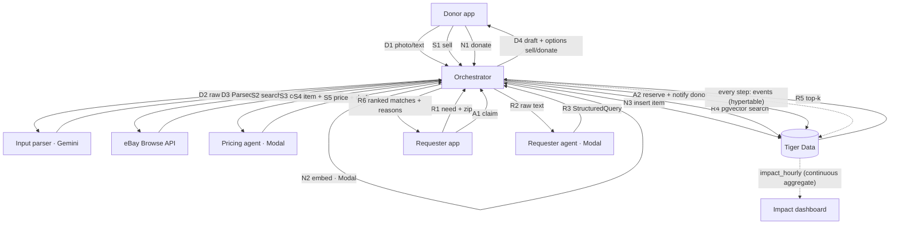
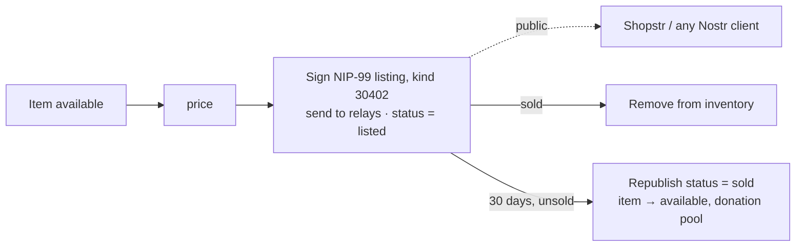

# 02 · Architecture

## Components

| Component | Where | Implementation | Sponsor |
|---|---|---|---|
| Donor app | `frontend/src/routes/(app)/donate` | Upload photo/text → see parsed item → choose **Sell** or **Donate** | – |
| Requester app | `frontend/src/routes/(app)/request` | Submit need + zip, show matches, claim one | – |
| Impact dashboard | `frontend/src/routes/(app)/feed` (+ `lib/ActivityFeed.svelte`, `lib/ImpactStats.svelte`) | Live stats from `/api/impact` + agent activity feed | – |
| Orchestrator | `backend/app/agents/orchestrator.py` | **Deterministic Python**, not an LLM loop. Routes work, embeds, reads/writes DB, ranks, emits every step as an event. The donor's UI choice decides sell vs donate, so no LLM routing. | – |
| Input parser agent | `backend/app/agents/parser.py` | Photo/text → `ParsedItem` via **Gemini API** (vision) | Gemini (MLH) |
| Pricing agent | `backend/app/agents/pricing.py` *(create)* | `ParsedItem` + eBay comps → price range + listing draft. LLM on **Modal**; comps from **eBay Browse API** | Modal |
| Donation step | orchestrator function, **not an LLM** | Modal embedding → DB insert | Modal |
| Requester agent | `backend/app/agents/requester.py` | Need text → `StructuredQuery`, LLM on **Modal** | Modal |
| Embeddings | `backend/app/core/llm.py` | Embedding model on **Modal** | Modal |
| Database | `backend/app/core/db.py` | **Tiger Data** (Postgres): pgvector for matching; `events` hypertable + `impact_hourly` continuous aggregate for stats. In-memory stub until wired. | Tiger Data (MLH) |
| eBay client | `backend/app/integrations/ebay.py` *(create)* | Browse API search (active listings) | – |
| Marketplace channel *(stretch)* | `backend/app/integrations/marketplace.py` | Signs and sends Nostr NIP-99 listings (shown on Shopstr) | – |
| Backend hosting | – | FastAPI on **Vultr or DigitalOcean** (pick one) | Vultr / DO (MLH) |
| Frontend hosting | – | SvelteKit on a **GoDaddy Registry** domain | GoDaddy (MLH) |
| Kiosk *(stretch)* | `kiosk/` *(create)* | Webcam + distance sensor donor input | Hardware track |

## Data flow

### Donor path

1. **D1** `POST /api/items/parse` with images and/or text, zip, donor_id.
2. **D2–D3** Orchestrator sends input to the parser agent; gets `ParsedItem` (see `05-agents.md`).
3. **D4** Orchestrator stores a **draft** (in memory or a `drafts` table; nothing in `items` yet) and returns `{draft_id, item, options: ["sell","donate"]}`.

**Sell** (`POST /api/items/{draft_id}/sell`)

1. **S2–S3** Orchestrator queries eBay Browse API for active listings matching the item.
2. **S4–S5** Pricing agent returns a price range and a listing draft. Response carries `basis: "active listings"`; the UI labels prices "currently listed for".
3. *(Stretch)* The donor can post the listing to Nostr/Shopstr; unsold after 30 days → donation pool. See below.

**Donate** (`POST /api/items/{draft_id}/donate`)

1. **N2** Orchestrator embeds `summary + attributes + item` on Modal.
2. **N3** Inserts an `items` row, `status = available`. Now searchable.

### Requester path

1. **R1** `POST /api/requests` with text and zip.
2. **R2–R3** Requester agent returns `StructuredQuery`.
3. **R4–R5** Orchestrator embeds `search_text`, runs pgvector search over `status = available`.
4. **R6** Drop below threshold, boost `+0.05` per `must_have` attribute present, one LLM call writes a ≤ 12-word reason per candidate, store `matches` as `suggested`, return the list. **Nothing is reserved yet.**
5. **A1–A2** `POST /api/matches/accept` re-checks the item is still `available`, sets it `reserved`, marks the match `accepted`, notifies the donor, returns handoff info.

### Handoff

The exchange method (pickup, drop-off point, shipping) is **undecided**. For the demo, the accept response says "reserved, donor notified, pickup in `<zip>`"; `donor_notified` is an event, not a real message.

## Design rules

- Only the orchestrator touches the DB (agents stay testable as pure prompt → JSON functions).
- Apps only talk to the orchestrator through the HTTP API.
- Every step emits an event to the `events` hypertable; the dashboard and feed read from it.

## Known risk: eBay comps

eBay's sold-listings API (`findCompletedItems`) is decommissioned; its replacement (Marketplace Insights API) needs eBay Business approval, unrealistic during a hackathon. **Use the Browse API (active listings)** and label prices "currently listed for". The pricing owner confirms Browse API access first. If eBay is unavailable (no key, error, or stub mode), pricing falls back to the category × condition heuristic already in `marketplace.suggest_price`, with `basis: "estimate"`.

## Stretch flow: marketplace (Nostr / Shopstr) + 30-day rule

Already built by ibrahim on `dev`.

- `backend/app/integrations/marketplace.py` builds and signs the listing (`d` tag = item id, so republishing replaces it) and sends it to `NOSTR_RELAYS` within ~8 s (4 s to connect + 4 s for relay OKs, hard cap 10 s); slow relays count as failed. Only the orchestrator calls it; it never touches the DB.
- Dry run by default: without `NOSTR_NSEC`, or with `MARKETPLACE_DRY_RUN=true`, events are signed with a throwaway key and not sent.
- Live mode with zero relays accepting → item stays `available`, error event, `502`.
- Channels share one small interface (`Channel`: `publish`, `mark_sold`). Roadmap: Etsy, Shopify, eBay selling (needs developer approval), each as another `Channel`.
- **Sell path → this channel (built, ibrahim):** after `/{draft_id}/sell`, the donor picks a price from the quote and calls `POST /api/items/{draft_id}/list` with `{"price": ...}`. The draft becomes an `items` row (not counted as a donation in impact) and is listed right away, so the 30-day rule can release it to the donation pool. `POST /api/items/{item_id}/list` still lists an existing available item; both accept an optional price (default: category × condition).

For the demo, `POST /api/admin/simulate-expiry` fast-forwards the 30 days.
