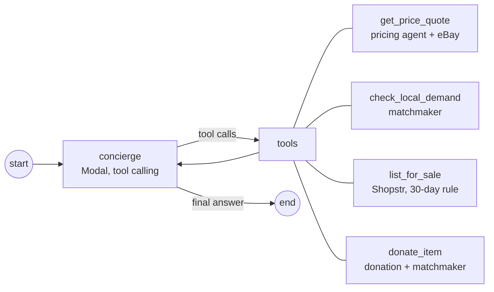

# 05 · Agents

Two kinds of agents:

- **The concierge** is a real agent loop (LangGraph): a tool-calling model decides which specialist to call, reads the results, and acts (lists or donates the item) on the donor's behalf.
- **Specialists** are **pure prompt → JSON functions**: no DB access, no side effects. Each must return **only JSON** matching its schema; the backend validates with Pydantic and retries once on a validation failure. The concierge reaches them as tools, through the orchestrator.

| Agent | Kind | Model | Provider |
|---|---|---|---|
| **Concierge** | agent loop, tool calling | text LLM | **Modal** (`infra/modal_llm.py`) via LangGraph |
| Input parser | specialist | vision LLM | **Gemini API** |
| Pricing | specialist | text LLM | **Modal** |
| Requester | specialist | text LLM | **Modal** |
| Matchmaker | specialist (vector search + rules) | embeddings | **Modal** / Tiger pgvector |
| Match reasons (inside orchestrator) | specialist | text LLM | **Modal** |
| Embeddings | – | embedding model | **Modal** |

All model calls go through `backend/app/core/llm.py`, except the concierge's, which uses LangChain's OpenAI-compatible client on the same Modal endpoint.

---

## Concierge agent (LangGraph + Modal)

`backend/app/agents/concierge.py`, called by `POST /api/items/{draft_id}/handle`. Takes over the chores after the donor uploads an item.



**System prompt:**
```
You are Rehome's concierge. A donor uploaded an item and wants it gone
without any more work. You do the work with your tools.
1. Call get_price_quote and check_local_demand.
2. Decide. Respect the donor's preference if it is "sell" or "donate". Otherwise:
   donate if someone nearby is waiting for this kind of item, or if it is worth
   under $15; else sell it.
3. Call exactly one of list_for_sale (price within the quoted range) or donate_item.
4. Reply to the donor in 2-3 plain sentences: what you did and why.
```

**Guardrails:** acts at most once per draft (a second list/donate call is refused); tool errors (e.g. price ≤ 0) go back to the model as the tool result so it can retry; recursion limit 12. If the model is unreachable, errors, or stops without acting, a **rule policy** finishes the run in the same graph (same decision rules as the prompt; list price = quote midpoint). Offline (no Modal) the rule policy is the brain from the start; `brain` in the response says which one decided.

## Matchmaker agent

After every donation (`/donate`, or the concierge's `donate_item`), embeds the item, searches requests that aren't `closed` (pgvector), applies the match threshold (plus stub re-ranking offline), and for each fit: inserts a `suggested` match, moves the request `open` → `matched`, and emits `matchmaker: itm_x may fit req_y (winter coat, zip 60601)`. The concierge's `check_local_demand` runs the same search read-only. Pydantic versions of these schemas live in `backend/app/schemas.py`.

**Shared attribute vocabulary.** The parser's `attributes` and the requester's `must_have` / `nice_to_have` must use the same words (insulated, waterproof, water-resistant, hooded, wool, fleece, padded, breathable, cordless, …) so both sides line up in vector space. Keep the list in one constant and include it in both prompts.

---

## Input parser agent (Gemini)

**Input:** image(s) and/or donor text.
**Output:** `ParsedItem`

```json
{
  "category": "outerwear | tops | bottoms | footwear | accessories | home | electronics | kids | other",
  "item": "string, short noun phrase",
  "brand": "string or null",
  "color": "string",
  "size": "string or null",
  "condition": "new | like new | good | fair",
  "season": "winter | summer | all | null",
  "attributes": ["2–6 strings"],
  "summary": "one sentence a buyer would read"
}
```

**System prompt (starting point):**
```
You catalog secondhand items. Look at the photo(s) and read the donor's text.
Return ONLY a JSON object with exactly these keys: category, item, brand,
color, size, condition, season, attributes, summary.
- category must be one of: outerwear, tops, bottoms, footwear, accessories,
  home, electronics, kids, other.
- brand and size: read them from a visible tag or the donor's text; otherwise
  null. Never guess.
- attributes: 2–6 short functional properties a person searching might care
  about, chosen from this vocabulary when possible: {ATTRIBUTE_VOCAB}.
- condition: judge from the photo; prefer the donor's text if it says.
No prose, no markdown fences.
```

---

## Pricing agent (Modal + eBay Browse API)

**Input:** `ParsedItem` + up to ~10 comps from the eBay Browse API (active listings), fetched by the orchestrator, not the agent.
**Output:** `PriceQuote`

```json
{
  "suggested_price": { "low": 0, "high": 0, "currency": "USD" },
  "comps": [ { "title": "", "price": 0, "condition": "", "source": "ebay", "url": "" } ],
  "listing_draft": { "title": "≤ 80 chars", "description": "2–4 sentences" }
}
```
The orchestrator adds `basis` (`"active listings"` or `"estimate"`). `comps` are the ones the agent judged comparable (subset of the input).

**System prompt (starting point):**
```
You price secondhand items. You get an item and a list of active eBay
listings. Discard listings that are not the same kind of item. From the rest,
suggest a realistic resale range for this item's condition (asking prices run
higher than sale prices; aim below the median). Write a listing title
(≤ 80 chars, brand + item + size + condition) and a 2–4 sentence description.
Return ONLY JSON with keys: suggested_price {low, high, currency}, comps,
listing_draft {title, description}. No prose, no markdown fences.
```

**Fallback:** no eBay access, eBay error, or no usable comps → orchestrator uses `marketplace.suggest_price` (category default × condition) as the midpoint, ±20 %, `comps: []`, template listing draft, `basis: "estimate"`.

---

## Requester agent (Modal)

**Input:** free text + zip.
**Output:** `StructuredQuery`

```json
{
  "needs": ["string", "..."],
  "inferred_context": ["string", "..."],
  "must_have": ["attribute", "..."],
  "nice_to_have": ["attribute", "..."],
  "size": "string or null",
  "search_text": "string optimized for similarity search"
}
```

**System prompt (starting point):**
```
You turn a person's request for secondhand items into a search query.
Infer practical context the person did not say: climate from the location
and month, activity, age group. Translate that context into concrete item
attributes from this vocabulary: {ATTRIBUTE_VOCAB}.
Return ONLY a JSON object with exactly these keys: needs, inferred_context,
must_have, nice_to_have, size, search_text.
- needs: the core items, as short noun phrases.
- must_have: attributes without which the item would not serve the need.
- search_text: one line combining needs and attributes; no location names.
No prose, no markdown fences.
```

---

## Orchestrator

**Deterministic Python: the service layer under the agents.** It owns the DB and runs each flow step by step. On the manual path the donor's UI choice decides sell vs donate; on the "let Rehome handle it" path the **concierge agent** decides and calls these same orchestrator functions as tools. The only LLM call inside the orchestrator itself writes match reasons.

**Parse:** `parse_item → store draft → emit item_parsed`
**Sell:** `ebay.search(draft) → pricing agent (or fallback) → emit price_quoted`
**Donate (plain function):** `embed(summary + attributes + item) → insert item (available) → emit item_donated`

**Request:**
1. `parse_request → embed(search_text) → pgvector search (status = available, top_k)`
2. Drop candidates with `score < MATCH_THRESHOLD`.
3. Re-rank: `final = score + 0.05 × (# must_have attributes present)`.
4. One LLM call writes a reason (≤ 12 words) per remaining candidate.
5. Insert `matches` (`suggested`), set request `matched` (or `open`), emit `match_made`. **Do not reserve.**

**Accept:** re-check item is `available` → set `reserved`, match `accepted`, request `closed` → emit `match_accepted` + "donor notified".

**Reason prompt:**
```
For each candidate item, write one reason (max 12 words) explaining why it
fits this request, or what it lacks. Return ONLY a JSON array of
{"item_id": "...", "reason": "..."}.
Request: {query JSON}
Candidates: {list of item summaries + attributes}
```

---

## Stub mode (no model configured)

Each provider stubs independently: no `GEMINI_API_KEY` → stub parser; no `MODAL_ENDPOINT_URL` → stub requester, pricing, reasons, embeddings; no eBay keys → pricing fallback. With nothing configured, the whole demo runs deterministically and offline. The stubs live in `backend/app/agents/stub_rules.py` (pure functions, same JSON schemas as above):

- **Parser:** keyword rules read category, item, color, size (only if stated), condition, season, and attributes from the text. `brand` is `null`. A photo with no text reads as a black puffer jacket (the item the demo script photographs).
- **Requester:** infers climate from month words, place names, then zip (cold zips only imply winter gear for outerwear/accessories): Chicago + December → `must_have: ["insulated", "water-resistant"]`. "For my daughter" → kids items only.
- **Embeddings:** hashed bag of words with plural/synonym folding (`pots` → `cookware`, `jacket` → `coat`).
- **Ranking:** threshold `0.2` instead of `MATCH_THRESHOLD`; searches `3 × TOP_K` candidates, adds +0.1 for the requested category, drops kids/adult mismatches and other-category items that meet no `must_have`, then keeps `TOP_K`. `waterproof` satisfies `water-resistant`.
- **Reasons:** template, ≤ 12 words: "Insulated and water-resistant, built for sub-freezing winters" · "Wool and warm, but not insulated" · "Not boots, but insulated and waterproof".

With a model configured, the reason call falls back to these templates if the model fails.

## Events to emit

Every step emits an event (activity feed + Tiger hypertable). `event_type` is set only on the steps the impact dashboard counts.

| Step | agent | event_type | Example message |
|---|---|---|---|
| Demo seed | orchestrator | – | Loaded 18 demo items into inventory |
| Upload received | orchestrator | – | New item received |
| Parsed | parser | `item_parsed` | Identified black Columbia puffer jacket, size M |
| Comps fetched | orchestrator | – | Found 8 active eBay listings |
| Priced | pricing | `price_quoted` | Suggested $35–55 (currently listed for) |
| Donated | orchestrator | `item_donated` | Saved itm_0142 as available |
| Request received | orchestrator | `request_made` | New request from 60601 |
| Query built | requester | – | Inferred snow and sub-freezing winters; needs insulated, water-resistant |
| Search done | orchestrator | – | Found 3 candidates |
| Matched | orchestrator | `match_made` | Top match itm_0142 (0.89) |
| No match | orchestrator | – | No good match yet; request left open |
| Accepted | orchestrator | `match_accepted` | itm_0142 reserved; donor notified, pickup in 54311 |
| Priced for listing *(stretch)* | orchestrator | – | Priced itm_0142 at $25 (outerwear, like new) |
| Listed *(stretch)* | orchestrator | – | Listed itm_0142 on Shopstr — 3/3 relays · or · Listed itm_0142 on Shopstr (dry run) |
| No public photo *(stretch)* | orchestrator | – | Heads up: itm_0142 has no public photo, so Shopstr hides it. Set PUBLIC_BASE_URL to a public URL (e.g. a tunnel) and relist |
| Listing failed *(stretch)* | orchestrator | – | Couldn't list itm_0142 on Shopstr — 0/3 relays accepted; item stays available |
| Expired *(stretch)* | orchestrator | – | 30 days unsold — itm_0142 moved to donation pool |
